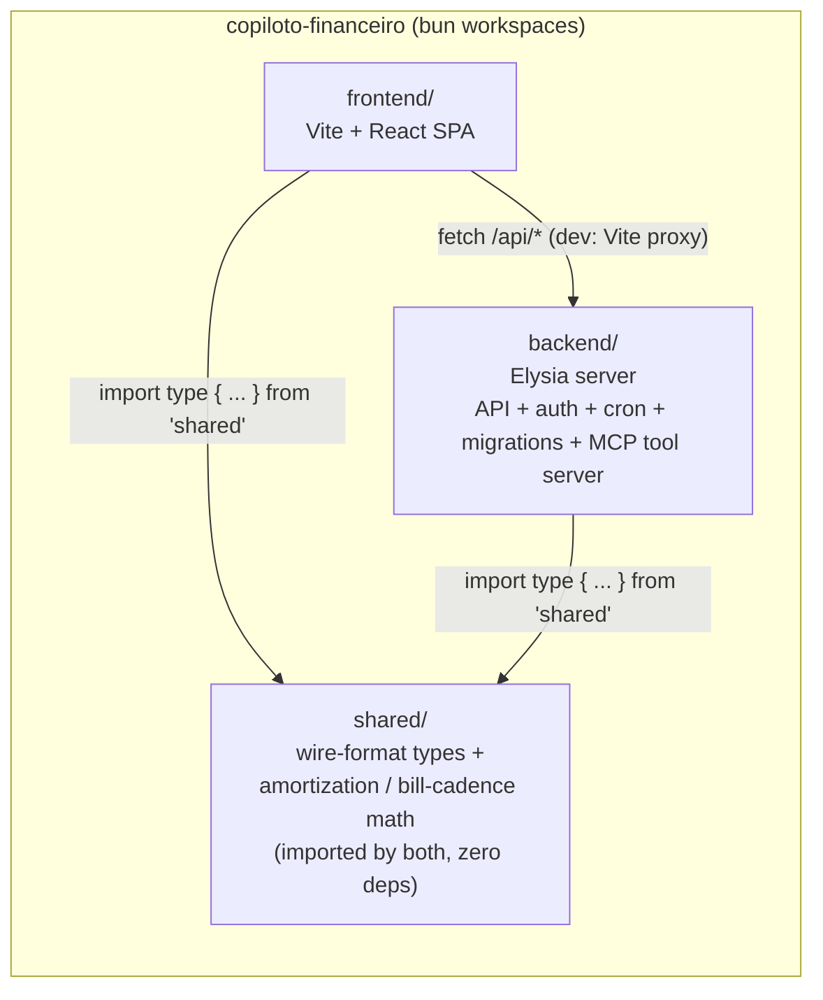
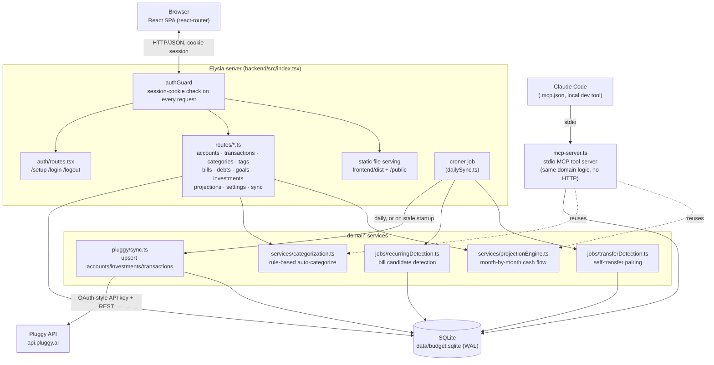
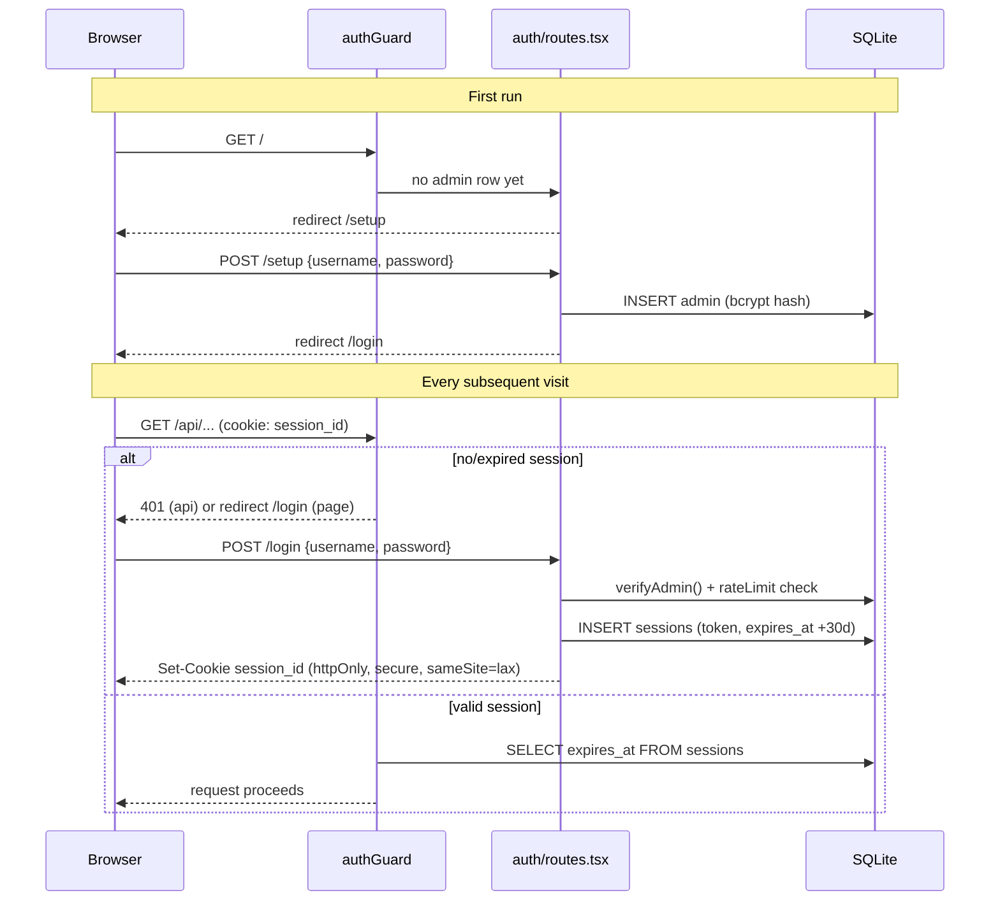
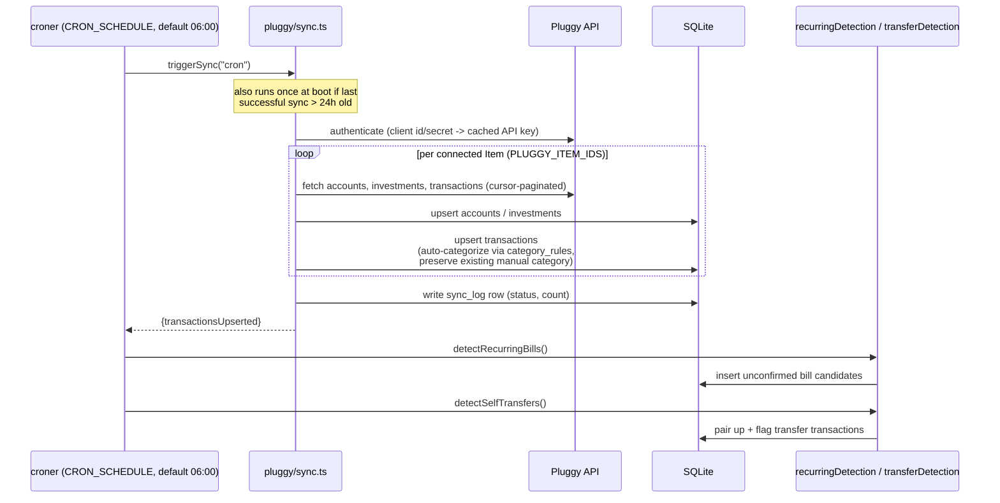
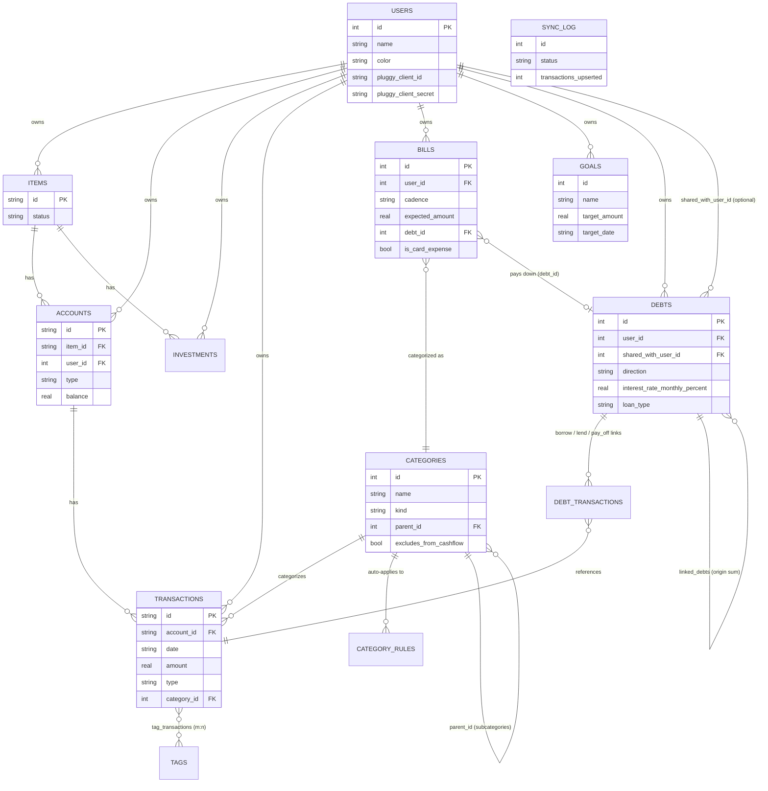
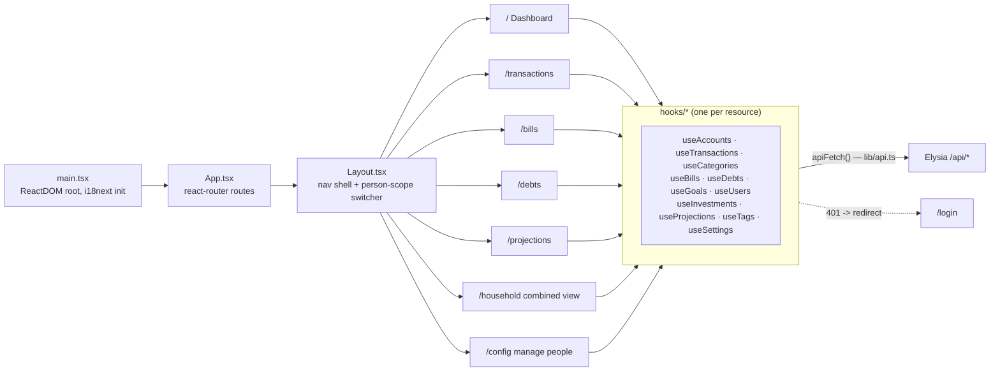
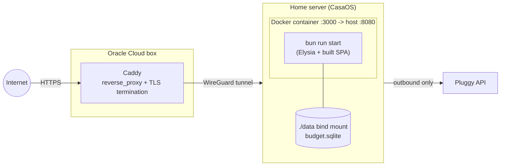

# Architecture

Self-hosted personal budget tracker for a household. Pulls transaction history from
[Pluggy](https://docs.pluggy.ai/) (Brazilian open-finance aggregator) once a day, stores
it in SQLite, and turns it into categorized spending, recurring bills, debt payoff
tracking, and a month-by-month cash-flow projection. Login is single-admin (no
multi-tenant auth), but the data model supports multiple household member profiles
under that one login — each with their own Pluggy connection and accounts, rolled up
in a combined Household view, with debts optionally shared between two people.

## Monorepo layout

A Bun workspace with three packages sharing a single lockfile.

- `bun run dev` — backend + frontend dev servers together (via `concurrently`); or
  `bun run dev:backend` (`:3000`, hot reload, migrations run on boot) and
  `bun run dev:frontend` (Vite, proxies `/api` and `/public` to the backend) separately
- `bun run build` / `bun run start` — production: Vite build served as static files by
  the same Elysia process (single container, single port)

## Runtime components

Everything runs as **one Bun process**: HTTP API, cron scheduler, and static file
server. The MCP server (`mcp-server.ts`) is a separate entry point over stdio, launched
on demand by an MCP client (e.g. Claude Code, per `.mcp.json`) — it calls the same
route/service functions the HTTP API uses, so business logic isn't duplicated.

## Auth flow

Single-admin login: no signup, no multi-tenant auth concerns. Session is a random
32-byte token in an httpOnly cookie, checked on every request by a global
`onBeforeHandle` hook. "Household member profiles" (the `users` table — see Data model
below) are a separate concept from login: they're per-person data scopes selected via
a nav dropdown once already authenticated, not separate accounts with their own
credentials.

Login attempts are rate-limited per IP (`auth/rateLimit.ts`). Redirects always go
through `lib/redirect.ts`'s `redirectTo()` — calling Elysia's `redirect()` directly is
broken whenever a cookie is touched in the same handler chain.

## Daily sync pipeline

A single in-memory `isRunning` flag prevents overlapping syncs (cron tick + manual
`POST /api/sync/run` racing). Pluggy pagination is cursor-based, not offset-based —
important because credit-card balances can double-count if pagination assumptions are
wrong (this bit the project once — see Pluggy client for the fix).

## Data model (core tables)

SQLite, sequential migrations (`backend/src/db/migrations/*.sql`), applied
automatically on boot by `db/index.ts`. Simplified ER diagram of the main entities:

Notable modeling decisions:

- **Categories and tags stay global** (one shared taxonomy across the household) —
  every other person-owned table (`accounts`, `transactions`, `bills`, `debts`,
  `goals`, `investments`, `sync_log`, `items`) carries a `user_id`, backfilled onto a
  seeded default user (id 1) so the migration that added it needed no data migration
  script. `GET` routes accept an optional `?userId=` — omitted means "Household"
  (every person combined), not "no filter for an unscoped table."
- **A shared debt is still exactly one row.** `debts.shared_with_user_id` is a nullable
  pointer to the other household member, additive on top of the pre-existing
  `split_percentage`/`debt_links`/`debt_transactions` math — a shared debt is summed
  once in the Household rollup, not once per party.
- **Categories** exclude "Transfers" / "Savings & Investments" from cash-flow totals via
  `excludes_from_cashflow`, while still counting real money movement in breakdowns.
- **Debts** support both informal IOUs (history-inferred payment schedule) and formal
  amortizing loans (PRICE/SAC formula from `shared/src/amortization.ts`), unified behind
  one `payment_plan` shape (`loan` | `combined` | `none`) so the Debts page and the
  projection engine can never disagree about a debt's schedule.
- **Bills** carry cadence (weekly/monthly/quarterly/yearly/once) and can optionally link
  to a debt they pay down (`debt_id`) — many bills can point at one debt.

## Cash-flow projection

`services/projectionEngine.ts` walks forward month by month from the current account
balances, netting baseline income/expense against confirmed bills, active debt payment
plans (loan formula or bill/history-derived), and an optional card-spend goal override —
producing the `ProjectedMonth[]` the frontend charts and the `shortfall` flags surface.

## Frontend

- `lib/api.ts` centralizes fetch + error handling: a 401 response hard-redirects to
  `/login` (session expired), other non-2xx responses raise `ApiError`.
- `lib/personScope.tsx` holds the globally-selected person (or `null` for Household),
  persisted to `localStorage`; every resource hook reads it and appends `?userId=` to
  its request, so switching people in the nav re-scopes the whole app at once.
- i18next with `en`/`pt` namespaced JSON locale files per feature area
  (`i18n/locales/{en,pt}/*.json`).
- No global state library — each page composes the resource hooks it needs; hooks own
  their own fetch/cache lifecycle (React Query). **Pages never call `apiFetch`,
  `useQuery`, or `useMutation` directly** — that always goes through a named hook in
  `hooks/*.ts`; a page or component that needs a form always delegates to its own
  component in `components/*.tsx` rather than defining a `<form>` inline. See
  `CONTRIBUTING.md` for the full convention.

## MCP tool server

`backend/src/mcp-server.ts` exposes the same domain operations (list/create/update
transactions, categories, bills, debts, goals; trigger sync; run categorization/
recurring-bill/self-transfer detection) as MCP tools over stdio, so an MCP client (this
project uses Claude Code, wired via `.mcp.json`) can drive the app directly — e.g. the
`add-category-rules`, `confirm-recurring-bills`, and `reconcile-debts` skills in this
repo's `.claude/` setup call these tools rather than hitting HTTP.

## Deployment

Single `Dockerfile` builds the whole monorepo (`bun install --frozen-lockfile` →
`bun run build`) into one image; `docker-compose.yml` runs it with the SQLite file on a
bind-mounted volume so data survives container rebuilds. The app itself is never
directly internet-facing — it sits behind a Caddy reverse proxy reached over WireGuard,
and relies on its own login + rate limiting as defense-in-depth rather than DDoS/exposure
hardening.
