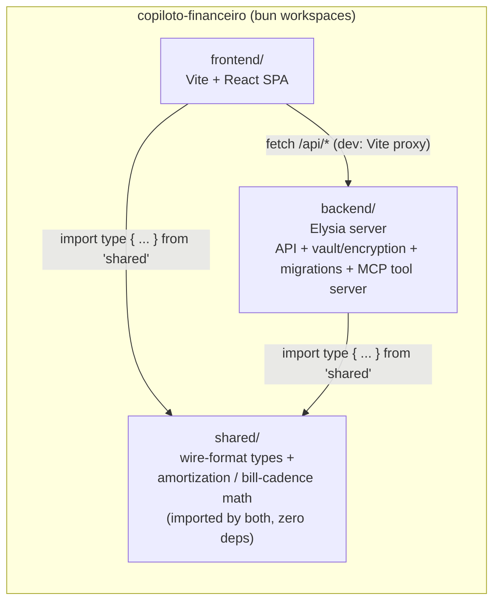
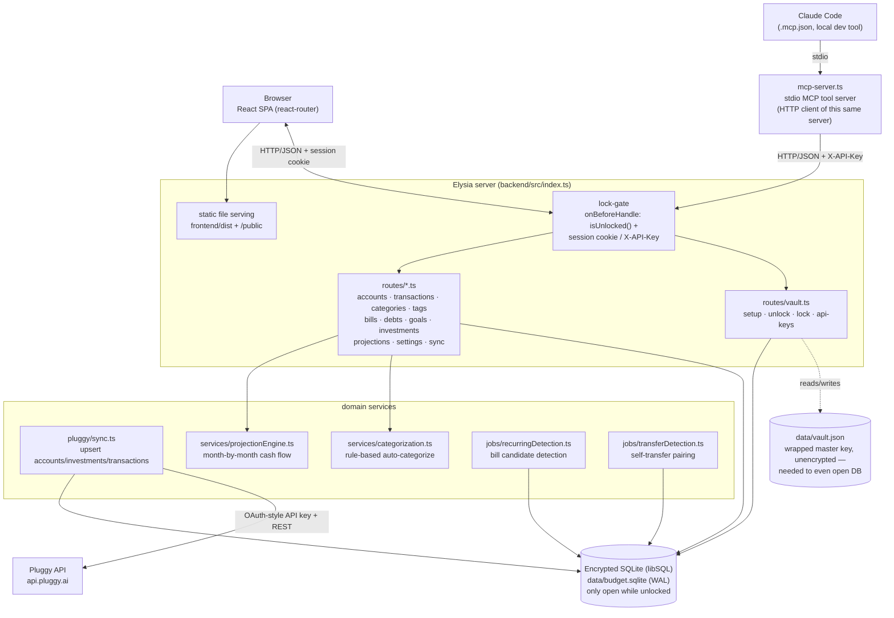
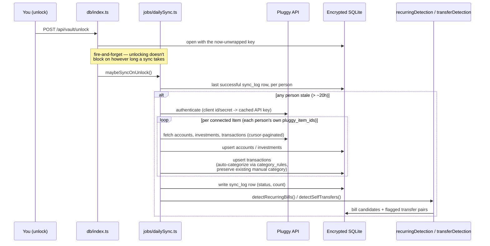
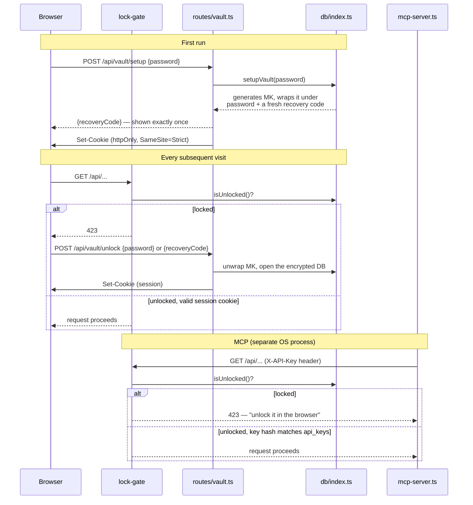
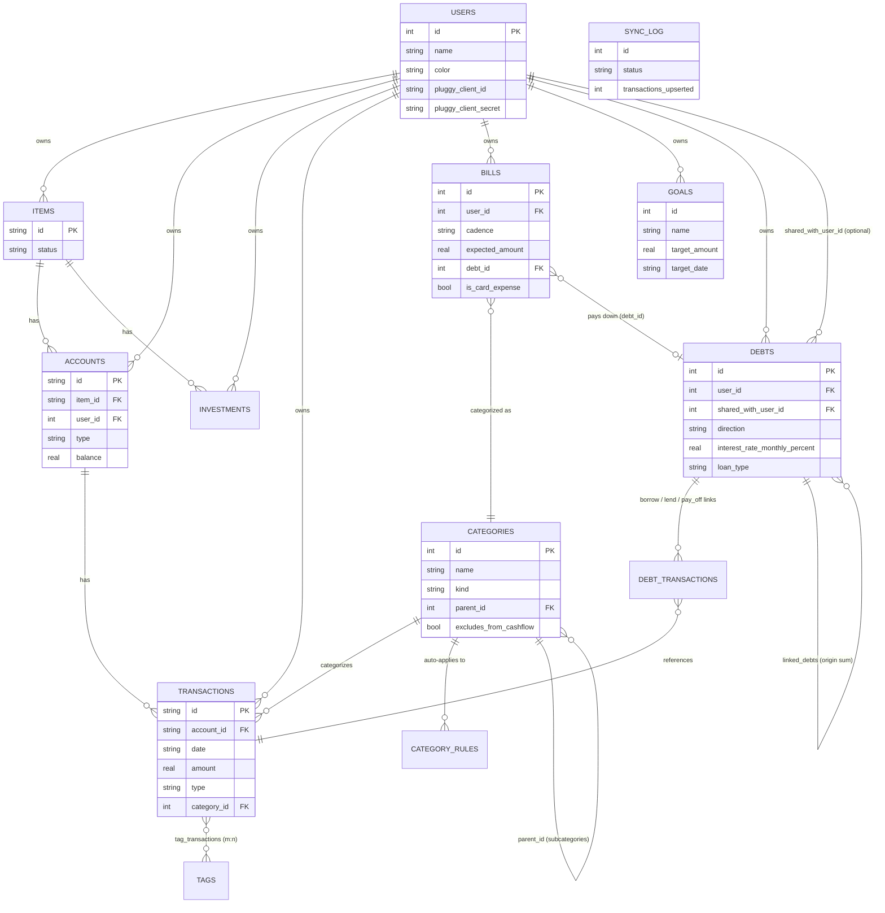
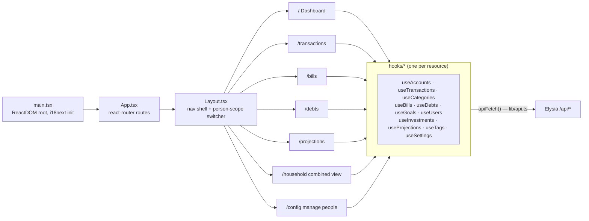
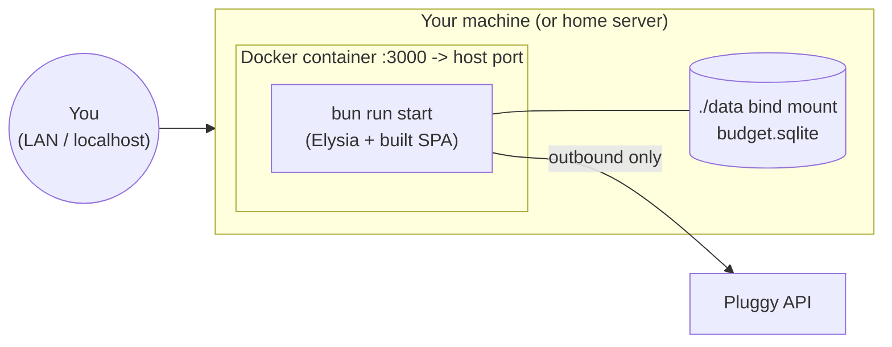

# Architecture

Self-hosted personal budget tracker for a household. Pulls transaction history from
[Pluggy](https://docs.pluggy.ai/) (Brazilian open-finance aggregator), stores it in a
SQLite database encrypted at rest, and turns it into categorized spending, recurring
bills, debt payoff tracking, and a month-by-month cash-flow projection. Meant to run
locally or on a trusted network — there's no login/account system; instead the
database itself is locked behind a password you choose (see "Encryption & unlock"
below). The data model supports multiple household member profiles (the `users`
table), each with their own Pluggy connection and accounts, rolled up in a combined
Household view, with debts optionally shared between two people.

## Monorepo layout

A Bun workspace with three packages sharing a single lockfile.

- `bun run dev` — backend + frontend dev servers together (via `concurrently`); or
  `bun run dev:backend` (`:3000`, hot reload, migrations run on boot) and
  `bun run dev:frontend` (Vite, proxies `/api` and `/public` to the backend) separately
- `bun run build` / `bun run start` — production: Vite build served as static files by
  the same Elysia process (single container, single port)

## Runtime components

Everything runs as **one Bun process**: HTTP API, the vault's encrypted database
connection, and static file server. There's no background scheduler — see "Sync" below
for why. The MCP server (`mcp-server.ts`) is a **separate OS process**, launched on
demand by an MCP client (e.g. Claude Code, per `.mcp.json`) — but unlike before this
app encrypted its data, it never touches the database or a service function directly.
It's a plain HTTP client of this same server's `/api/*` routes, authenticated with an
API key, for one reason: only the main server process ever holds the decryption key in
memory, so locking it instantly revokes access for the browser and MCP alike, with
nothing cached anywhere to go stale. See "Encryption & unlock" below.

## Sync

No background scheduler — a locked-by-default app that may sit closed for days doesn't
suit a cron tick (it either fires while locked and fails, or never fires at all if
nothing's running at the scheduled hour). Sync instead runs right after unlock, only if
it's actually due, reusing the exact same `triggerSync()` the manual "sync now" button
and the `trigger_sync` MCP tool call. A single in-memory `isRunning` flag prevents
overlapping syncs (an unlock-triggered sync racing a manual one). Pluggy pagination is
cursor-based, not offset-based — important because credit-card balances can
double-count if pagination assumptions are wrong (this bit the project once — see
Pluggy client for the fix).

## Encryption & unlock

The database is encrypted at rest (libSQL's `encryptionKey`, not plain `bun:sqlite`) —
the real master key (MK) is random, generated once, and never derived live from a
human secret. Your password and a separately-generated, shown-once recovery code each
independently _wrap_ that same MK (`node:crypto` scrypt + AES-256-GCM, see
`vault/crypto.ts`) — either one unlocks it, and a wrong one fails loudly via the GCM
auth tag, not a silent garbage read. Both wrapped copies live in `data/vault.json`,
which has to stay unencrypted (you need it to even open the database) and is exactly
as sensitive as the password + recovery code combined — back up the whole `data/`
directory as one unit, not just this file or just the `.sqlite`.

Two independent gates sit on top of `isUnlocked()`, not one — a global "is the vault
cryptographically open" boolean alone doesn't distinguish _your_ browser tab from
another tab or a malicious page (a real class of attack: "localhost CSRF" / DNS
rebinding), and gives MCP no principled way in without a password it can't store
anywhere safe:

- **Browser**: a random session token, `httpOnly` + `SameSite=Strict` cookie, issued
  on setup/unlock. `SameSite=Strict` means a request _initiated by another site_ never
  carries it, even to the right origin — that's what actually blocks the
  localhost-CSRF class of attack.
- **MCP**: a real, user-managed API key (`routes/vault.ts`'s `api_keys` table,
  generated from `/config`, shown once, stored **hashed** — SHA-256, not scrypt, since
  the key is already 256 bits of uniform randomness with no guessing attack to defend
  against, unlike a human password). Stable across lock/unlock cycles by design — it
  isn't rotated or revoked by locking, `isUnlocked()` is what actually gates real
  access on top of it. `mcp-server.ts` reads the raw key from `data/mcp-api-key`
  (`chmod 600`), saved there once per machine after generating it in the browser.

Locking (`POST /api/vault/lock`) closes the database connection and clears the session
cookie — both the browser and every MCP tool call lose access in the same instant,
through the same `isUnlocked()` check, with nothing cached anywhere to go stale.

## Data model (core tables)

SQLite, sequential migrations (`backend/src/db/migrations/*.sql`), applied
automatically on boot by `db/index.ts`. Simplified ER diagram of the main entities:

Notable modeling decisions:

- **Categories and tags stay global** (one shared taxonomy across the household) —
  every other person-owned table (`accounts`, `transactions`, `bills`, `debts`,
  `goals`, `investments`, `sync_log`, `items`) carries a `user_id`, backfilled onto a
  seeded default user (id 1) so the migration that added it needed no data migration
  script. `GET` routes accept an optional `?userId=` — omitted means "Household"
  (every person combined), not "no filter for an unscoped table."
- **A shared debt is still exactly one row.** `debts.shared_with_user_id` is a nullable
  pointer to the other household member, additive on top of the pre-existing
  `split_percentage`/`debt_links`/`debt_transactions` math — a shared debt is summed
  once in the Household rollup, not once per party.
- **Categories** exclude "Transfers" / "Savings & Investments" from cash-flow totals via
  `excludes_from_cashflow`, while still counting real money movement in breakdowns.
- **Debts** support both informal IOUs (history-inferred payment schedule) and formal
  amortizing loans (PRICE/SAC formula from `shared/src/amortization.ts`), unified behind
  one `payment_plan` shape (`loan` | `combined` | `none`) so the Debts page and the
  projection engine can never disagree about a debt's schedule.
- **Bills** carry cadence (weekly/monthly/quarterly/yearly/once) and can optionally link
  to a debt they pay down (`debt_id`) — many bills can point at one debt.

## Cash-flow projection

`services/projectionEngine.ts` walks forward month by month from the current account
balances, netting baseline income/expense against confirmed bills, active debt payment
plans (loan formula or bill/history-derived), and an optional card-spend goal override —
producing the `ProjectedMonth[]` the frontend charts and the `shortfall` flags surface.

## Frontend

- `lib/api.ts` centralizes fetch + error handling: any non-2xx response raises
  `ApiError`.
- `lib/personScope.tsx` holds the globally-selected person (or `null` for Household),
  persisted to `localStorage`; every resource hook reads it and appends `?userId=` to
  its request, so switching people in the nav re-scopes the whole app at once.
- i18next with `en`/`pt` namespaced JSON locale files per feature area
  (`i18n/locales/{en,pt}/*.json`).
- No global state library — each page composes the resource hooks it needs; hooks own
  their own fetch/cache lifecycle (React Query). **Pages never call `apiFetch`,
  `useQuery`, or `useMutation` directly** — that always goes through a named hook in
  `hooks/*.ts`; a page or component that needs a form always delegates to its own
  component in `components/*.tsx` rather than defining a `<form>` inline. See
  `CONTRIBUTING.md` for the full convention.

## MCP tool server

`backend/src/mcp-server.ts` exposes the same domain operations (list/create/update
transactions, categories, bills, debts, goals; trigger sync; run categorization/
recurring-bill/self-transfer detection) as MCP tools over stdio, so an MCP client (this
project uses Claude Code, wired via `.mcp.json`) can drive the app directly — e.g. the
`add-category-rules`, `confirm-recurring-bills`, and `reconcile-debts` skills in this
repo's `.claude/` setup call these tools. Each tool is a thin wrapper around a real
`fetch()` call to this same server's own `/api/*` routes (see "Encryption & unlock"
above for why it's HTTP now, not an in-process function call) — authenticated with an
API key from `data/mcp-api-key`, generated once from `/config`. If the vault is
locked, or the server isn't running, or there's no valid key on file, a tool call fails
with a specific, actionable error instead of a generic exception.

## Deployment

Single `Dockerfile` builds the whole monorepo (`bun install --frozen-lockfile` →
`bun run build`) into one image; `docker-compose.yml` runs it with `./data` (the
encrypted `.sqlite` file, `vault.json`, and `mcp-api-key` together) on a bind-mounted
volume so data survives container rebuilds. `HOST=0.0.0.0` is set inside the container
(required for Docker's port-mapping to reach it at all — `127.0.0.1` inside a
container is its own loopback, unreachable from outside it), with the **host**-side
port mapping restricted to `127.0.0.1` instead, same effective result as the bare
(non-Docker) default. The database being encrypted doesn't change the advice: this is
still built to stay on your machine or local network, not port-forwarded onto the open
internet — once unlocked, the API itself has no further per-request login, same
reasoning as always. Reach it remotely via something like Tailscale instead of exposing
the port directly.
